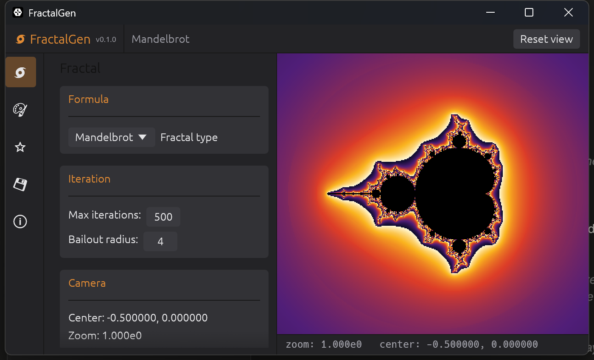

# FractalGen

A GPU-accelerated fractal explorer built in Rust, with true deep zoom via
perturbation theory, still-image and animation export, and a
Blender-inspired dark UI.



## Features

- **Fractal kinds**: Mandelbrot, Julia (click-to-seed), Burning Ship,
  Tricorn, and Multibrot (configurable power).
- **Deep zoom**: an arbitrary-precision camera plus a perturbation-theory
  GPU pipeline (in-shader glitch detection/rebasing, CPU-side secondary-
  reference correction) reaching roughly 1e250x on Mandelbrot and Julia, on
  GPUs that support `SHADER_F64`.
- **Coloring**: 8 built-in palettes, a gradient stop editor, and an optional
  distance-estimator shading mode that reveals fine boundary detail.
- **Interactive viewport**: pan/zoom-at-cursor, click-to-seed Julia sets.
- **Export**: still-image PNG export with supersampling; zoom-animation
  frame-sequence export with Linear/Exponential/Accelerating zoom curves,
  an fps field with a live duration estimate, and optional video stitching
  via a system `ffmpeg` if present on `PATH`.
- **Bookmarks**: save/load/go-to named focus points.

See [CHANGELOG.md](CHANGELOG.md) for the full version history — it's also
shown in-app under the ℹ️ About tab.

## Requirements

- Rust (edition 2024 — install via [rustup](https://rustup.rs/))
- A GPU with Vulkan or DX12 support (the app renders via `wgpu`); deep zoom
  additionally needs a GPU/driver that exposes `SHADER_F64`
- Optional: [ffmpeg](https://ffmpeg.org/) on `PATH`, to stitch an exported
  animation's PNG frames into a video from within the app

## Building & running

```sh
cargo run --release --bin fractal_app
```

Run the test suite with:

```sh
cargo test --workspace
```

## License

MIT licensed — see [LICENSE](LICENSE). Copyright (c) 2026 Maxe.
